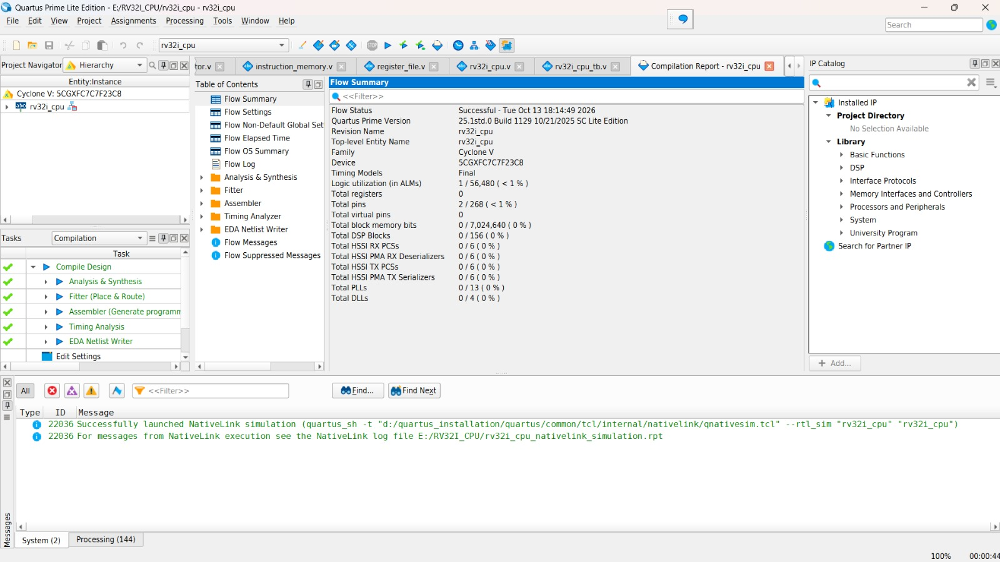
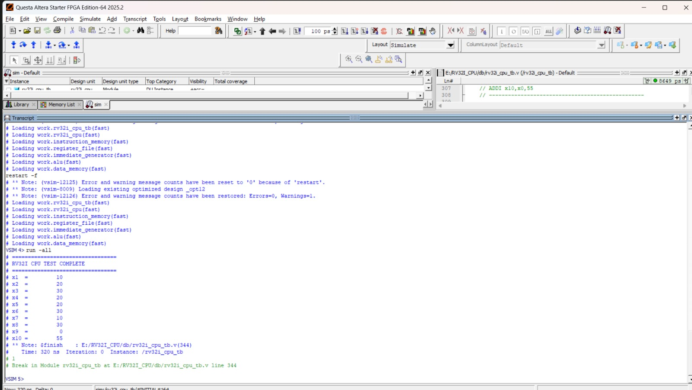
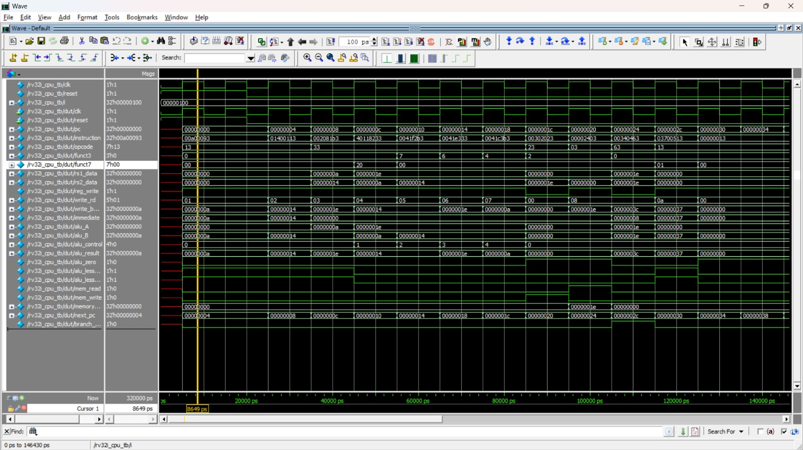

# RV32I RISC-V Processor Design and RTL Verification

**A 32-bit RISC-V CPU implementation using Verilog HDL, developed in Intel Quartus Prime Lite and verified through Questa/ModelSim simulation.**

## 1. Project Overview

This project focuses on the design and RTL-level verification of a basic processor based on the **RISC-V RV32I Instruction Set Architecture**.

The processor is organized into individual hardware modules, including the Arithmetic Logic Unit (ALU), Register File, Instruction Memory, Data Memory, and Immediate Generator.

A dedicated Verilog testbench is used to apply test inputs, execute instructions, and observe the processor's behavior through simulation waveforms and transcript logs.

## 2. Technical Specifications

| Parameter | Description |
|---|---|
| Processor Architecture | RISC-V |
| Instruction Set | RV32I |
| Data Width | 32-bit |
| HDL | Verilog |
| Design Tool | Intel Quartus Prime Lite |
| Simulation Tool | Questa/ModelSim |
| Verification Method | RTL Simulation |
| Testbench | Verilog HDL |

## 3. Processor Architecture and Modules

| Module | Function |
|---|---|
| `rv32i_cpu.v` | Top-level processor module |
| `alu.v` | Arithmetic and logical operations |
| `register_file.v` | 32-bit general-purpose register storage |
| `instruction_memory.v` | Instruction storage and retrieval |
| `data_memory.v` | Data read and write operations |
| `immediate_generator.v` | Immediate value extraction and generation |
| `rv32i_cpu_tb.v` | CPU testbench for functional verification |

## 4. RTL Design and Implementation

The processor is designed using a modular RTL approach. Each functional block is implemented as an independent Verilog module and integrated into the top-level CPU.

The design includes:
- Instruction processing and execution logic
- Program Counter (PC) operation
- Register read and write operations
- Arithmetic and logical execution
- Immediate value generation
- Instruction and data memory interfacing

## 5. CPU Testbench and Functional Verification

The CPU testbench (`rv32i_cpu_tb.v`) is developed to verify the processor's behavior during simulation.

The testbench provides the required clock and reset signals, executes the programmed instruction sequence, and monitors relevant CPU signals.

**Verification evidence:**

### CPU Testbench Execution Output



*Simulation output captured during CPU testbench execution.*

### Questa/ModelSim Transcript Log



*Transcript screenshot showing the simulation execution log.*

### RTL Simulation Waveform



*Waveform view used to observe processor signals and execution behavior over simulation time.*

## 6. Simulation and Verification Environment

The RTL design is compiled and simulated using Questa/ModelSim.

The simulation environment is used to:
1. Compile the Verilog design modules.
2. Compile the CPU testbench.
3. Initialize the processor using reset.
4. Apply clock signals.
5. Execute the instruction sequence.
6. Monitor processor signals.
7. Analyze simulation results using the transcript and waveform windows.

## 7. Project Directory Structure

```text
RV32I-CPU/
│
├── alu.v
├── data_memory.v
├── immediate_generator.v
├── instruction_memory.v
├── register_file.v
├── rv32i_cpu.v
├── rv32i_cpu_tb.v
│
├── rv32i_cpu.qpf
├── rv32i_cpu.qsf
│
├── cpu_waveform.png.jpeg
├── testbench_output.png.jpeg
└── questa_transcript.txt.jpeg
```

## 8. Tools and Technologies

- Verilog HDL
- RISC-V RV32I ISA
- Intel Quartus Prime Lite
- Questa/ModelSim
- RTL Design
- Functional Simulation
- Digital System Design

## 9. Future Scope

- Extend instruction support to cover more RV32I operations.
- Develop a five-stage pipelined RISC-V processor.
- Implement data forwarding and hazard detection.
- Improve verification with directed and randomized test cases.
- Explore FPGA-based hardware implementation.

## 10. Conclusion

This project provides practical experience in 32-bit processor architecture, RTL design, Verilog module integration, and simulation-based functional verification. It demonstrates the implementation and simulation workflow of a basic RISC-V processor.

## Author

**Nithish Kumar P**

**Domain:** Digital VLSI Design | Processor Architecture | RTL Design and Verification

**Repository:** RV32I RISC-V CPU
